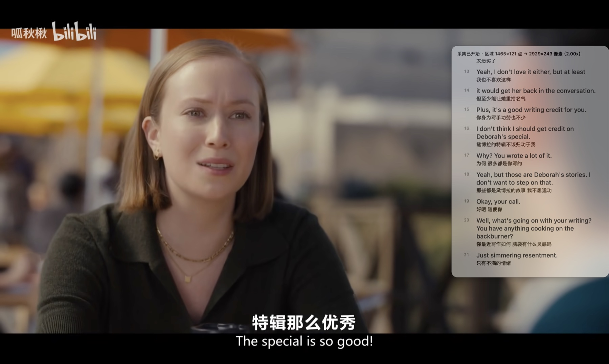
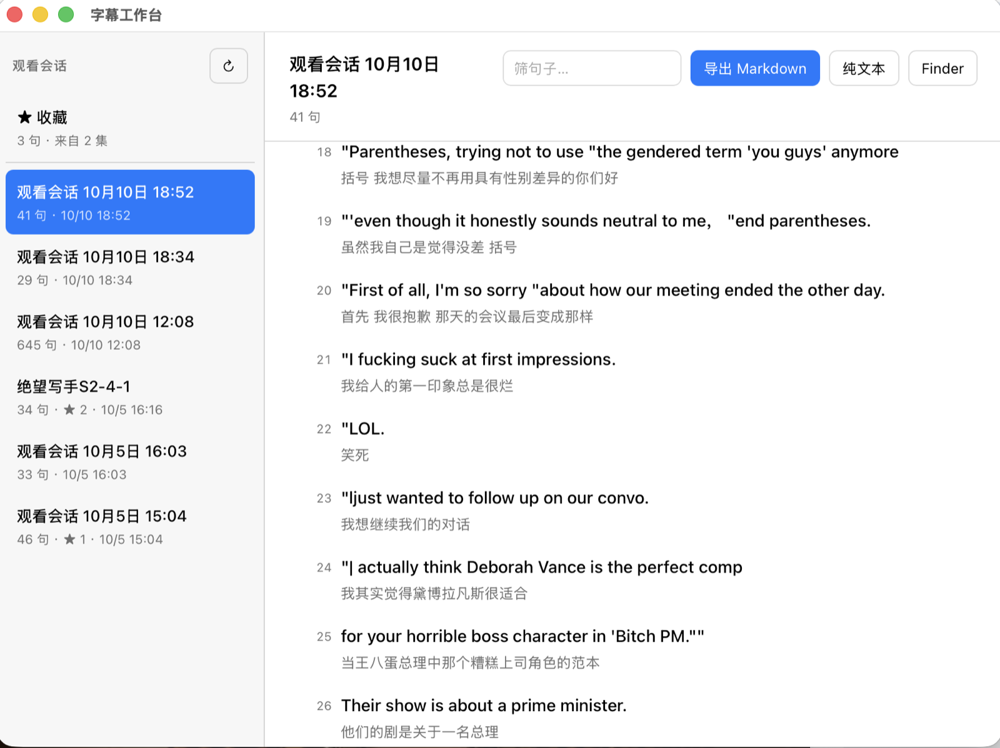
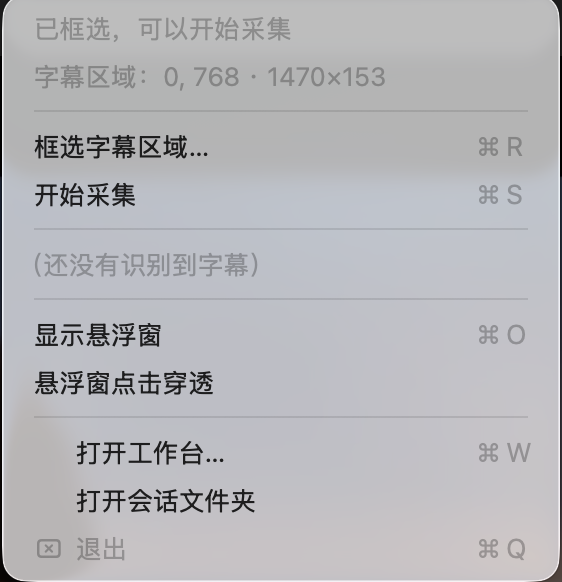

# 硬字幕学习

看剧学英语用。片源的中英字幕是**烧在画面里**的硬字幕（没有字幕轨，播放器也导不出文本），
这个 macOS 工具实时把它们 OCR 出来、在屏幕边上滚成一条字幕稿、按观看会话落盘，
最后导出成中英对照的背诵材料。

**只做屏幕层面的事**——不碰浏览器、不碰播放器、不碰网盘，也不要求你换播放器。
框一块区域罩住字幕那两行，剩下的交给它。

> App 就叫 `English.app`。最开始是给自己看美剧用的，名字没再改过。

---

## 适合谁

- 看**带硬字幕的**中英双语片源（美剧 / 电影 / 纪录片），想边看边攒背诵材料
- 用 macOS，愿意跑几条命令自己编译（没有现成的 .dmg，原因见下）
- 字幕是**烧在画面里**的，不是外挂的 `.srt` / `.ass`

## 不适合谁

先看清楚，省得白折腾：

- **外挂字幕（`.srt` / `.ass`）** —— 那种字幕你直接用播放器导出文本就行，比 OCR 准一万倍，
  用这个工具纯属自找麻烦。**这条是劝退的，不是谦虚。**
- **想要现成安装包** —— 没有签名分发、没有公证（notarization）、没有 `.dmg`，只能从源码编译。
  原因见[为什么必须自签名](#为什么必须自签名)。
- **片源带 DRM** —— Netflix / Disney+ 这类一般有 DRM。ScreenCaptureKit 抓 DRM 内容会让
  画面**整屏变黑**，什么都读不到，不是配置问题，绕不过去。
- **指望字字准确** —— OCR 有字符级噪声（`l`/`I` 粘连、全角标点、中文整行认错）。
  这个工具负责把噪声**成句、配对、择优**；字符级修正交给大模型，见[清洗导出稿](#清洗导出稿)。
- **Windows / Linux** —— 内核是纯 Swift、理论上能移，但采集层绑死
  ScreenCaptureKit + Vision，没有跨平台打算。

---

## 它长什么样



框住字幕那两行，悬浮窗就在旁边一句句往上滚，编号、中英对照。



工作台：左边是观看会话，右边是中英对照字幕稿，可以直接导出 Markdown / 纯文本，
也可以给句子打星收藏。

不用拍视频、不用给屏幕录制权限，也能看到界面长什么样：

```bash
swift run EnglishApp --demo-overlay   # 悬浮窗摆满假数据，调排版用
swift run EnglishApp --workbench      # 直接打开工作台
```

---

## 怎么做的

```
框选一块区域 → 定时抓屏 → Vision OCR → 成句 → 配对中英 → 择优 → JSONL 落盘 → 导出
```

几个不那么显然的地方：

- **必须框选。** 实测全屏 OCR 每帧出十几行噪音（播放器 UI、背景里的字），
  框住字幕那两行之后就只剩两行，配对的难度直接归零。
- **去重必须模糊匹配。** 同一句字幕跨帧的 OCR 结果**必然**不同（`- `、大小写、
  `I↔l`、`you↔ygu`……），字符串相等完全失效。所以用归一化编辑距离。
- **confidence 不能当过滤阀。** 实测英文行常年 0.30–0.50 但内容是对的，
  而纯噪音也有 0.50 —— 拿它过滤会先把好句子滤掉。它只在择优里占极低权重。
- **中英两行独立择优。** 两行的 OCR 质量互不相关（中文笔画密，比英文更容易崩），
  所以两个变体池分开投票，不取平均。
- **不翻译。** 实测片源都是中英双行，中文本来就在画面上，翻译是多余的。

内核 `EnglishCore` 是纯函数式状态机：吃 `[FrameInput]`、吐 `[SubtitleEntry]`，
不碰屏幕、不碰 UI、连时间和分词器都是注入的 —— 所以它能脱离屏幕被反复回归。

---

## 快速开始

需要 macOS 15+ 和 Swift 6 工具链。**不需要完整 Xcode**，CommandLineTools 就够
（构建走 SwiftPM + 一个手写的打包脚本，见 `Scripts/package_app.sh`）。

```bash
git clone <这个仓库>
cd English

# 1. 建一张自签名证书（只跑一次）。⚠️ 会改登录钥匙串的信任设置，不需要 sudo
Scripts/setup_signing.sh

# 2. 打包
Scripts/package_app.sh

# 3. 打开
open build/English.app
```

第一次采集时系统会问屏幕录制权限，**给 `English.app` 授权**（不是给终端）。
数据落在 `~/Library/Application Support/English/sessions/<id>/`，一集一个目录，
纯 JSONL，`cat` 就能看。

### 用法

菜单栏出现一个 💬 图标：



| 菜单项 | 说明 |
|---|---|
| 框选字幕区域… `⌘R` | 拖一个框罩住字幕那两行。**框选结果会记住**，下次自动应用 |
| 开始采集 / 停止采集 `⌘S` | 开始后悬浮窗冒出来，字幕一句句往上滚 |
| 显示/隐藏悬浮窗 `⌘O` | |
| 悬浮窗点击穿透 | 挡住画面时打开，鼠标事件直接穿过去 |
| 打开工作台… `⌘W` | 会话列表 → 字幕稿 → 导出中英对照文档。可改会话名、可给句子打星收藏 |
| 打开会话文件夹 | 数据就在这儿 |

**框要大一点。** 框得比字幕窄，长句会被切掉；框得矮，三行字幕会被切掉。
这是实测踩出来的——切掉的字，算法没法补回来。

---

## 配置

证书名和 bundle id 是**每台机器不一样**的东西，从 `Scripts/local.env` 读（该文件被
`.gitignore` 挡着，不会进仓库）：

```bash
cp Scripts/local.env.example Scripts/local.env
```

| 变量 | 作用 |
|---|---|
| `BUNDLE_ID` | App 的 bundle id，默认 `dev.hardsub.english` |
| `CERT_NAME` | 签名用的证书名，默认 `English Local Dev` |

---

## 为什么必须自签名

这一步看起来多余，其实是这个工具最容易踩的坑，也是它不太可能做成
「下载即用」的原因。

屏幕录制权限（TCC）锚定在 **bundle id + 代码签名的指定要求**上：

- **ad-hoc 签名**（`codesign -s -`）的指定要求里含 **cdhash**，而 cdhash
  **每次重新编译都会变**（源码变一点就变）。系统于是认为这是另一个程序 →
  权限失效 → 每次重编译都要重新授权一遍。开发时这个循环会把人逼疯。
- **自签名证书**签出来的指定要求是稳定的（只有证书指纹，没有 cdhash）→
  授权一次，之后重编译、重启电脑都还在。

这就是 `Scripts/setup_signing.sh` 存在的全部理由。它用 `openssl` 生成一张带
`codeSigning` 扩展的自签证书、导进登录钥匙串、并加上代码签名信任 ——
**会改钥匙串的信任设置**（不需要 sudo），跑之前请自己看一眼脚本。

权限搞乱了就重置一次：

```bash
tccutil reset ScreenCapture dev.hardsub.english   # 换成你自己的 BUNDLE_ID
```

---

## 验证

改任何东西之前，先确认这几条能跑通。它们都是自动断言的，失败时退出码非 0。
**改算法必跑 1；改落盘（改名/收藏/导出）必跑 2；改工作台前端必跑 3、4。**

```bash
# 1. 纯逻辑回归 —— 不需要屏幕、不需要视频，129 项检查
swift run core-check

# 2. 落盘自检 —— 改名 / 收藏 / 导出，全程在临时目录，不碰真实数据，38 项断言
swift run EnglishApp --selftest-store

# 3. 工作台前端回归 —— 76 项检查。极简 DOM 桩 + 真 payload，不需要浏览器
node Scripts/workbench-check.js

# 4. 上面那个检查器的反向对照 —— 8 个变异全部要被咬住
node Scripts/workbench-check-mutants.js
```

下面三条依赖真实屏幕，靠人看输出判断（做成自动断言只会是假绿）：

```bash
# 5. 采集链体检 —— 打印每帧 OCR 结果与跳帧率
swift run capture-check 353 184 342 202 6 --dump /tmp/frames

# 6. 自排除对照实验 —— 确认悬浮窗不会被自己 OCR 一遍
./build/English.app/Contents/MacOS/English --selftest-capture

# 7. 不开界面导出
./build/English.app/Contents/MacOS/English --export all md
```

### 调试开关

| 开关 | 用途 |
|---|---|
| `--demo-overlay` | 不开视频、不要权限，悬浮窗摆满假数据调排版 |
| `--workbench` | 启动就打开工作台 |
| `--auto-start x y w h` | 跳过框选直接开采集 |
| `--auto-stop <秒>` | 配合 `--auto-start`：N 秒后自动停止并退出。走的是和 ⌘S **同一条**取消路径 |
| `--selftest-capture` | 自排除对照实验 |
| `--selftest-store` | 改名 / 收藏 / 导出的落盘自检（临时目录，不碰真实数据） |
| `--export <id\|all> [md\|txt]` | 命令行导出 |

> `--auto-stop` 是补出来的。在此之前「停止采集」这条路**没有任何无头跑法**——只能手点菜单，
> 于是它坏掉了也没人测得到：点停止会报「采集出错：CancellationError()」，
> 而且收尾整段被跳过，最后那句没定稿的字幕直接丢。现在一行命令就能跑到那条路径：

```bash
./build/English.app/Contents/MacOS/English --auto-start 0 800 1470 108 --auto-stop 8
```

### 为什么要自己写断言器，不用 `swift test`

**只有 CommandLineTools、没有完整 Xcode 时，`swift test` 会编译通过、退出码 0、
但一条测试都不执行。** 把测试改成故意失败，依然退出 0、零输出。

所以回归器是一个普通可执行目标 `EnglishCoreCheck`，用 `swift run core-check` 跑。
详见 `Package.swift` 顶部的注释。

### 两条关于「检查」本身的规矩

- **第 4 条是给第 3 条做的反向对照。** 一份永远全绿的检查比没有检查更坏——它让人
  以为改动是安全的。这个脚本把每个修过的 bug 的逆操作重新打回 `app.js`，看检查会不会
  变红、**红在该红的那条上**。
- **黄金夹具不是全覆盖。** 有一处实测：夹具那 27 帧**一次都没进入**状态机的 pending 分支，
  改那条路径时夹具改前改后都是全绿，那个绿对改动**零信息量**。拿真实数据生成的夹具，
  只覆盖它自己那段数据里出现过的情况；改了它没走过的分支，必须自己补用例。

更多约定见 [`docs/dev-workflow.md`](docs/dev-workflow.md)。

---

## 已知的不足

老实说，除了「v1 不做」的那些功能，内核还有两处**结构性**的毛病（不是 OCR 噪声，
规则和大模型都不好修，要改算法）：

- **一句英文占了两行**时，帧内配对器每帧只产出**一个**配对，于是帧与帧之间来回摇摆，
  一句话可能被切成两条。
- **同一行里两个说话人**时，`Find us a bar.-Onit.` 这种只会剥掉**开头**的说话人标记，
  不会从中间断开，两个说话人被并成了一条。

另外，转场或画面上的其他文字（尤其是播放器的进度条/时间码）如果落在框里，
会变成噪声条目，需要在工作台里手动删掉。

### v1 没做

翻译兜底（实测片源都是中英双行，用不上）· 播放器控制 / 单句循环 ·
遮挡画面中文字幕 · 字幕区域自动定位 · 云同步 / 账号 · 逐词查词 / 生词本

**节选收藏已做**（v1.1，见 [`docs/plan-workbench-v1.1.md`](docs/plan-workbench-v1.1.md)）：
句子打星 → 跨会话聚合 → 导出成一篇按来源分组的背诵材料。
仍未做：点收藏项跳回原句并滚动定位、单集内「只看收藏」筛选、删除会话。

---

## 清洗导出稿

OCR 的字符级噪声（`lappreciate` 其实是 `I appreciate`、全角逗号、中文整行乱认）
**规则修不了**——`l` 和 `I`、`l` 和 `l` 在字形上完全一样，`always` / `really` / `loved`
里也都是连写的 `l`，正则没法在不误伤的前提下区分。

所以 v1 **不在 App 里接模型**：导出 `export.md`，连同
[`docs/llm-cleanup-prompt.md`](docs/llm-cleanup-prompt.md) 里的提示词一起丢给任意大模型。
那份提示词写明了「哪些错必须改、哪些一个字都不许动、不确定怎么标」，
以及每条限制背后的代价。将来工作台接 API 只是把这步搬进 App，**内核一行不用改**。

---

## 代码结构

```
Sources/
  EnglishCore/          纯逻辑内核。不碰屏幕、不碰 UI、不碰时间与词典
    Models.swift          数据模型
    TextNormalizer.swift  两套清洗：storeText（入库）vs compareKey（比对）
    Similarity.swift      模糊匹配（OCR 抖动导致字符串相等必然失效）
    Favorites.swift       收藏模型 + favorites.json 编解码（纯逻辑，不读时钟）
    FramePairer.swift     语种分类 + 帧内中英配对
    SubtitleAssembler.swift  状态机 + 变体池 + 择优成句
  EnglishCapture/       采集层。依赖系统 API，不可离线测
    ScreenCapturer.swift  SCK 抓屏 + 自排除 + Retina 缩放系数
    OCREngine.swift       Vision 封装
    RegionPicker.swift    原生框选
    CaptureSession.swift  轮询 + 帧指纹跳帧
  EnglishApp/           菜单栏 App
    AppDelegate.swift     菜单栏 + 各调试开关
    CaptureCoordinator.swift  串起 采集→组装→落盘→UI
    OverlayPanel.swift    悬浮字幕稿
    WorkbenchWindow.swift WKWebView 工作台 + JS 桥接
    Exporter.swift        中英对照文档生成（会话全量 / 跨会话收藏）
    SessionStore.swift    JSONL 落盘 + 改名 + 收藏读写
    StoreSelfTest.swift   落盘自检（--selftest-store）

Resources/Workbench/    工作台的网页资源（html/css/js）
Scripts/                打包与签名
spike/                  早期技术验证，归档保留
docs/                   需求 / 工作流 / 计划 / LLM 清洗提示词
```

**为什么内核必须零依赖**：`EnglishCore` 是全项目最值钱、最容易写错的部分，
也是最容易脱离屏幕和视频被反复回归的部分。所以所有系统交互都被推到调用方，
连时间戳和分词器都是注入的。

---

## License

[MIT](LICENSE)
